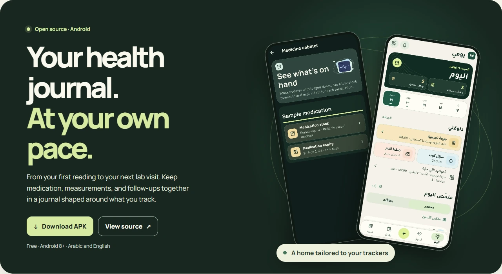
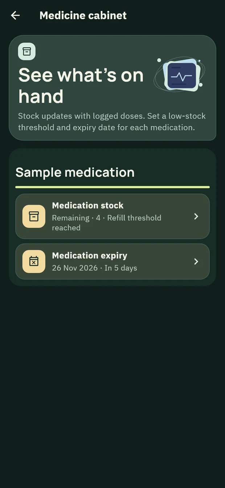
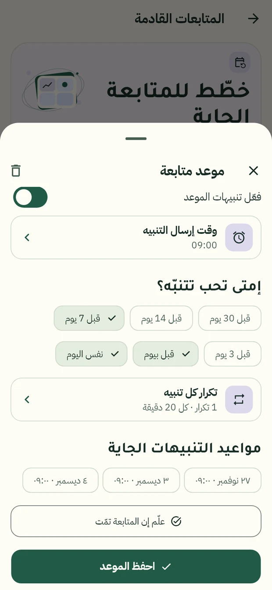
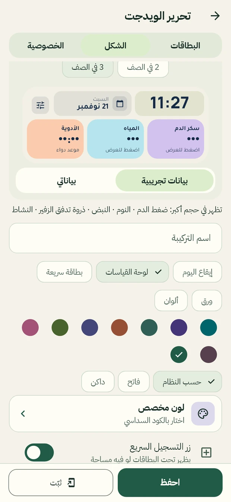
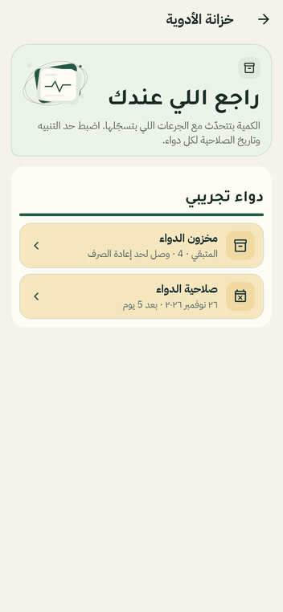

<p align="center">
  <a href="https://mohamedabdelnaby1.github.io/yawmi/?lang=en">
    
  </a>
</p>
<p align="center">
  <a href="https://github.com/Mohamedabdelnaby1/yawmi/releases/latest/download/Yawmi-Android.apk"></a>
</p>
<p align="center">
  <a href="https://mohamedabdelnaby1.github.io/yawmi/?lang=en">Website</a> ·
  <a href="https://github.com/Mohamedabdelnaby1/yawmi/releases/latest">Release notes</a> ·
  <a href="README.md" lang="ar">العربية</a>
</p>

# Yawmi

**A free, open-source Android health journal.** Yawmi started as a diabetes journal and grew into a journal for tracking the health routines that matter to you. Choose what to follow during setup and arrange the Today screen around your routine.

| Medicine cabinet | Dated follow-ups | Widget studio |
| :-: | :-: | :-: |
|  |  |  |

<details>
<summary>See the medication expiry transition</summary>



</details>

## Features

- **Tracking and trends.** Log glucose, blood pressure, water, and other measurements. Compare periods and share a visit summary.
- **Medications and inventory.** Add dose times and meal context. Stock adjusts when doses are logged. Set a threshold and choose how often low-stock reminders repeat.
- **Expiry and follow-ups.** Record a medication expiry date, plan a repeat lab test or visit, and select advance alerts, their time, and repeats. Completing a follow-up clears its remaining alerts.
- **Flexible reminders.** Schedule water reminders during waking hours, set quiet hours, and test Android notification delivery from the app.
- **Home-screen widgets.** Pick the cards, clock, date, and shortcuts that appear on each widget.
- **Languages and data.** Arabic and English with light and dark modes. Journal data stays on your device. Export PDF or CSV, or create an encrypted backup.

The screenshots use sample data. Yawmi is a personal logging and reminder tool.

## Download and build

[**Download the latest Android APK**](https://github.com/Mohamedabdelnaby1/yawmi/releases/latest/download/Yawmi-Android.apk) · [SHA-256](https://github.com/Mohamedabdelnaby1/yawmi/releases/latest/download/Yawmi-Android.apk.sha256)

Requires Android 8 or later. Android may ask for permission to install the APK from the app that opens it. To test reminders, visit **Today → bell → Delivery on this device**.

Use Flutter 3.50.1, JDK 21 and Android SDK 36. The Android project pins the NDK and Gradle versions. Some plugins also need SDK 35.

```sh
flutter pub get
flutter test
YAWMI_SIGNING_MODE=testing flutter build apk --release
```

On Windows, `./build-android.ps1` stages the project in an ASCII path if your checkout path includes Arabic characters. Signing options are documented in the script.

## Contributing

Please include your Yawmi version and Android version when [filing an issue](https://github.com/Mohamedabdelnaby1/yawmi/issues). Use sample entries in screenshots. The code is available under the [MIT License](LICENSE). Bundled font licenses are in [assets](assets). [Privacy](https://mohamedabdelnaby1.github.io/yawmi/privacy.html#english).

Designed and built by **Mohamed Abdelnaby**, in loving memory of his parents **Abdelnaby Abdelfattah** and **Fatma Bedeir Assal**.
