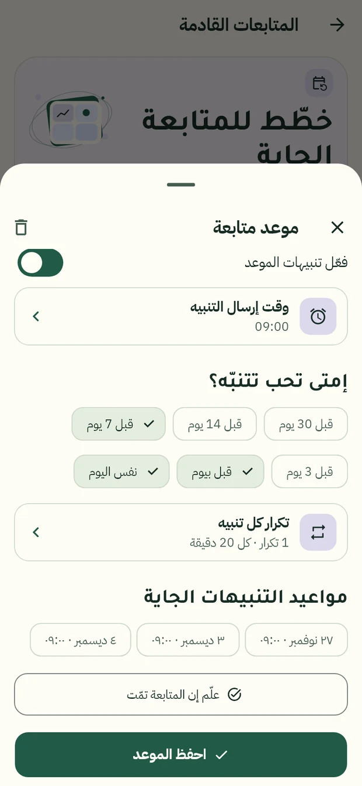
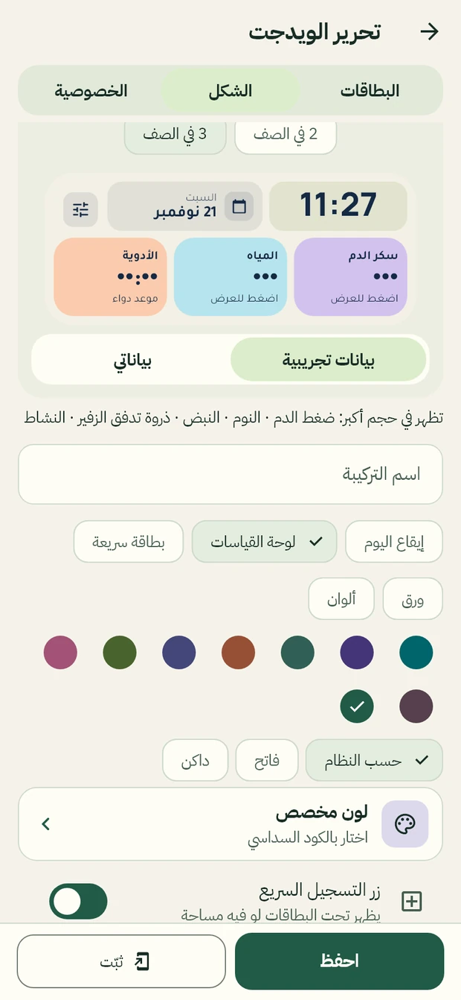

<p align="center">
  <a href="https://mohamedabdelnaby1.github.io/yawmi/">
    
  </a>
</p>
<p align="center">
  <a href="https://github.com/Mohamedabdelnaby1/yawmi/releases/latest/download/Yawmi-Android.apk"></a>
</p>
<p align="center">
  <a href="https://mohamedabdelnaby1.github.io/yawmi/">صفحة التطبيق</a> ·
  <a href="https://github.com/Mohamedabdelnaby1/yawmi/releases/latest">تفاصيل الإصدار</a> ·
  <a href="README.en.md" lang="en">English</a>
</p>

# يومي

**دفتر صحي مجاني ومفتوح المصدر لأندرويد.** بدأ كتطبيق لمتابعة السكر، واتوسّع بعد اقتراح صاحب عشان أي حد يقدر يرتّب متابعته الصحية اليومية. اختار اللي بتتابعه عند أول تشغيل ويومي يرتّب لك صفحة «اليوم» على أساسه.

| خزانة الأدوية | مواعيد المتابعة | استوديو الويدجت |
| :-: | :-: | :-: |
|  |  |  |

<details>
<summary>شوف حركة فتح إعدادات صلاحية الدواء</summary>


</details>

## إيه اللي تقدر تعمله؟

- **القياسات واليوم.** سجّل السكر والضغط والمياه وغيرها، ورتّب البطاقات واختصارات التسجيل حسب اختيارك. قارن الفترات وشارك ملخّص للزيارة.
- **الأدوية والمخزون.** اضبط وقت الجرعة وعلاقتها بالوجبة. المخزون بيتحدّث مع تسجيل الجرعة. التنبيه يشتغل عند حد الكمية اللي تختاره ويتكرر حسب إعدادك لحد ما تجدّد الكمية.
- **الصلاحية والمتابعة.** سجّل تاريخ الصلاحية الظاهر على العبوة، أو تاريخ إعادة تحليل أو زيارة. اختار التنبيه قبل الموعد بيوم أو أسبوع أو بأكتر من فترة. تقدر تضبط الساعة، وتكرار كل تنبيه، وتعلّم إن المتابعة تمّت.
- **المياه والإشعارات.** وزّع تذكيرات المياه بين الصحو والنوم، واضبط أوقات الهدوء واختبر الإشعارات من داخل التطبيق.
- **الويدجت.** اختار البطاقات والقيم اللي تظهر والساعة والتاريخ، واضبط أكتر من نسخة للشاشة الرئيسية.
- **اللغة والبيانات.** عربي وإنجليزي، ووضع فاتح أو داكن. السجل على جهازك. شارك PDF أو CSV باختيارك، أو احفظ نسخة مشفّرة بكلمة مرور.

معاينات الشاشات فيها بيانات تجريبية. يومي أداة تسجيل وتذكير للمتابعة الشخصية.

## التحميل والبناء

[**حمّل أحدث APK لأندرويد**](https://github.com/Mohamedabdelnaby1/yawmi/releases/latest/download/Yawmi-Android.apk) · [بصمة SHA-256](https://github.com/Mohamedabdelnaby1/yawmi/releases/latest/download/Yawmi-Android.apk.sha256)

يتطلب أندرويد 8 أو أحدث. عند التثبيت من خارج المتجر، أندرويد ممكن يطلب إذن التثبيت من التطبيق اللي فتحت الملف منه. لاختبار وصول التذكيرات، افتح «اليوم ← الجرس ← وصول الإشعارات على جهازك».

المشروع يستخدم Flutter ‏3.50.1 وJDK ‏21 وAndroid SDK ‏36. إصدارات NDK وGradle مثبتة في ملفات Android. قد تحتاج بعض الإضافات SDK ‏35 أيضًا.

```sh
flutter pub get
flutter test
YAWMI_SIGNING_MODE=testing flutter build apk --release
```

على ويندوز، استخدم `./build-android.ps1` لبناء APK تجريبي لو مسار المشروع فيه حروف عربية. تفاصيل خيارات التوقيع متاحة في السكربت.

## المساهمة والحقوق

لو هتفتح [مشكلة أو اقتراح](https://github.com/Mohamedabdelnaby1/yawmi/issues)، استخدم بيانات تجريبية واذكر نسخة التطبيق وأندرويد. كود يومي تحت [رخصة MIT](LICENSE). تراخيص الخطوط المضمّنة موجودة في [assets](assets). [خصوصية التطبيق](https://mohamedabdelnaby1.github.io/yawmi/privacy.html).

برمجة وتصميم **المهندس محمد عبدالنبي**. صدقة جارية على روح والده **المهندس عبدالنبي عبدالفتاح** ووالدته **الأستاذة فاطمة بدير عسل**. ربنا يرحمهما ويغفر لهما.
