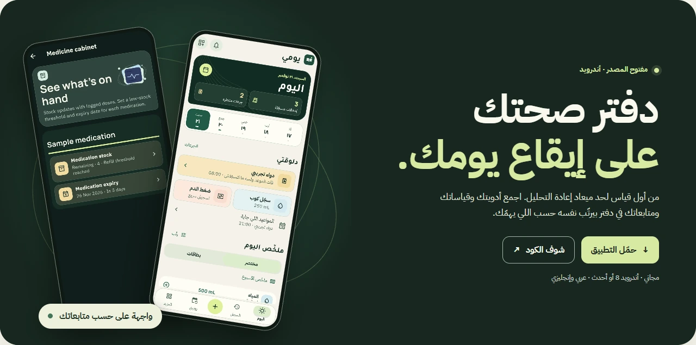
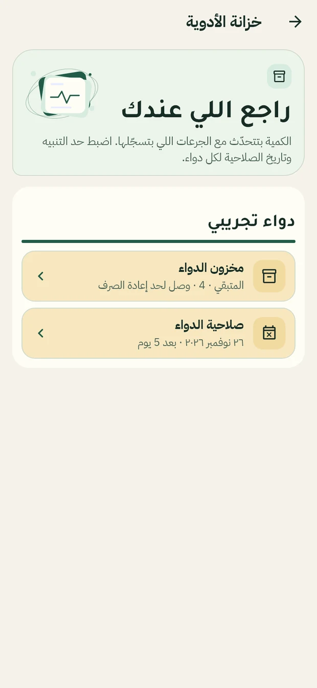
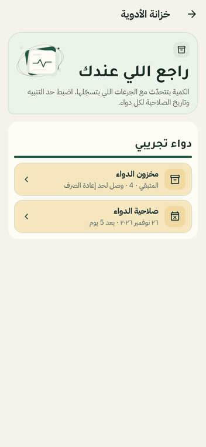
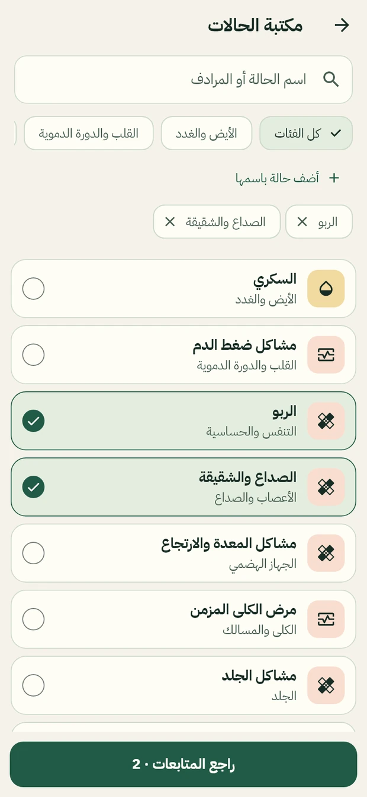
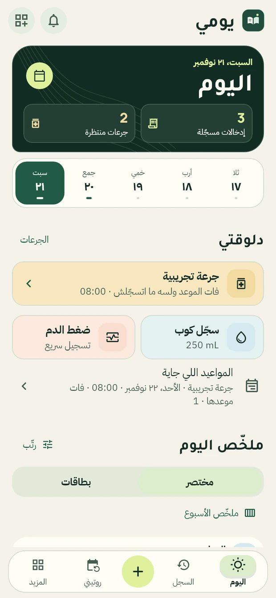
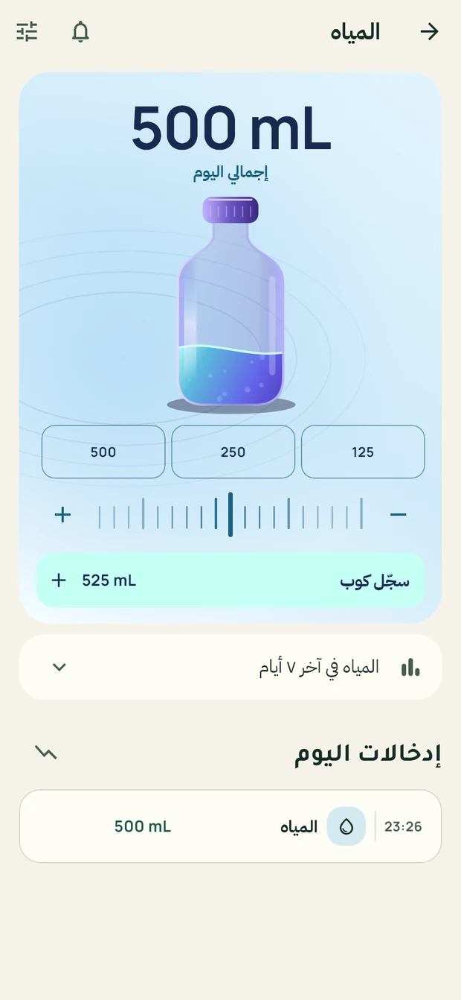
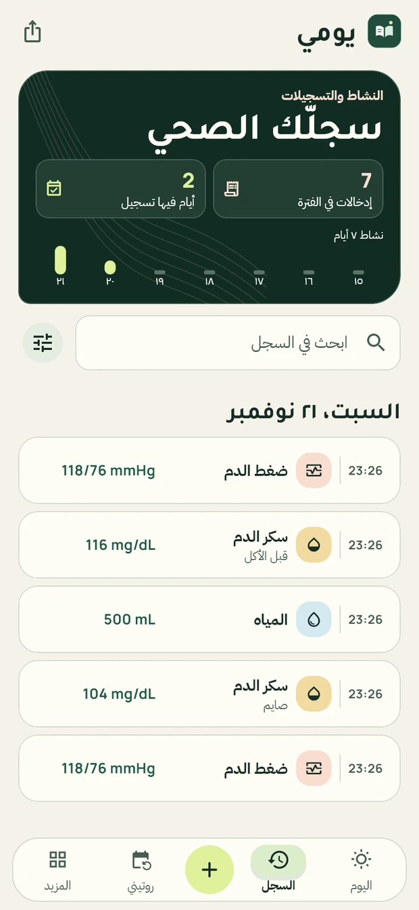
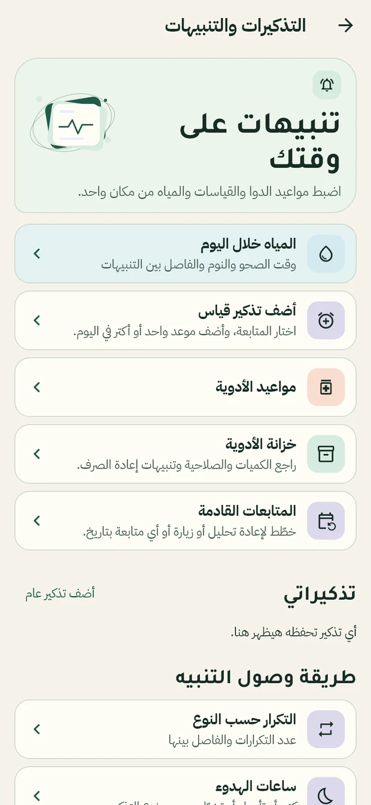
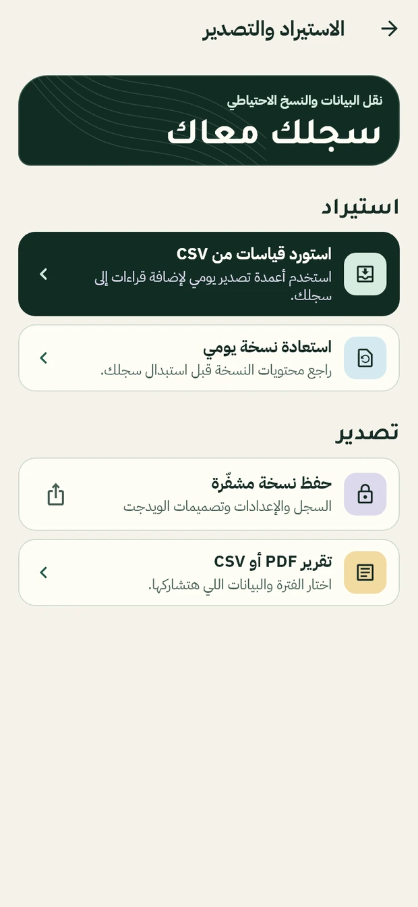

<p align="center">
  <a href="https://mohamedabdelnaby1.github.io/yawmi/">
    
  </a>
</p>
<p align="center">
  <a href="https://github.com/Mohamedabdelnaby1/yawmi/releases/latest/download/Yawmi-Android.apk"></a>
</p>
<p align="center">
  <a href="https://mohamedabdelnaby1.github.io/yawmi/">صفحة التطبيق</a> ·
  <a href="https://github.com/Mohamedabdelnaby1/yawmi/releases/latest">تفاصيل الإصدار</a> ·
  <a href="README.en.md" lang="en">English</a>
</p>

# يومي

**دفتر صحي مجاني ومفتوح المصدر لأندرويد.** بدأ كتطبيق لمتابعة السكر، واتوسّع بعد اقتراح صاحب عشان أي حد يقدر يرتّب متابعته الصحية اليومية. اختار اللي بتتابعه عند أول تشغيل ويومي يرتّب لك صفحة «اليوم» على أساسه.

| خزانة الأدوية | مواعيد المتابعة | استوديو الويدجت |
| :-: | :-: | :-: |
|  |  |  |

<details>
<summary>شوف حركة فتح إعدادات صلاحية الدواء</summary>



</details>

## إيه اللي تقدر تعمله؟

- **القياسات واليوم.** سجّل السكر والضغط والمياه وغيرها، ورتّب البطاقات واختصارات التسجيل حسب اختيارك. قارن الفترات وشارك ملخّص للزيارة.
- **الأدوية والمخزون.** اضبط وقت الجرعة وعلاقتها بالوجبة. المخزون بيتحدّث مع تسجيل الجرعة. التنبيه يشتغل عند حد الكمية اللي تختاره ويتكرر حسب إعدادك لحد ما تجدّد الكمية.
- **الصلاحية والمتابعة.** سجّل تاريخ الصلاحية الظاهر على العبوة، أو تاريخ إعادة تحليل أو زيارة. اختار التنبيه قبل الموعد بيوم أو أسبوع أو بأكتر من فترة. تقدر تضبط الساعة، وتكرار كل تنبيه، وتعلّم إن المتابعة تمّت.
- **المياه والإشعارات.** وزّع تذكيرات المياه بين الصحو والنوم، واضبط أوقات الهدوء واختبر الإشعارات من داخل التطبيق.
- **الويدجت.** اختار البطاقات والقيم اللي تظهر والساعة والتاريخ، واضبط أكتر من نسخة للشاشة الرئيسية.
- **اللغة والبيانات.** عربي وإنجليزي، ووضع فاتح أو داكن. السجل على جهازك. شارك PDF أو Excel بصيغة XLSX، أو احفظ نسخة مشفّرة بكلمة مرور.
- **ملفات العيلة والزيارات.** كل شخص له سجل محلي منفصل. خط المتابعة بيجمع التسجيلات وتغييرات المواعيد، وتقدر تربط نتائج وأسئلة بزيارة وتضبط ميعاد المتابعة بعدها.
- **قراءة من صورة.** اختار الحقول من النص اللي اتقرا من شاشة القياس أو ورقة التحليل أو عبوة الدوا. راجع القيمة والوحدة في النموذج قبل الحفظ.

معاينات الشاشات فيها بيانات تجريبية. يومي أداة تسجيل وتذكير للمتابعة الشخصية.

## التحميل والبناء

[**حمّل أحدث APK لأندرويد**](https://github.com/Mohamedabdelnaby1/yawmi/releases/latest/download/Yawmi-Android.apk) · [بصمة SHA-256](https://github.com/Mohamedabdelnaby1/yawmi/releases/latest/download/Yawmi-Android.apk.sha256)

يتطلب أندرويد 8 أو أحدث. عند التثبيت من خارج المتجر، أندرويد ممكن يطلب إذن التثبيت من التطبيق اللي فتحت الملف منه. لاختبار وصول التذكيرات، افتح «اليوم ← الجرس ← وصول الإشعارات على جهازك».

### جولة في التطبيق

[**شوف الجولة المتحركة للتطبيق**](https://mohamedabdelnaby1.github.io/yawmi/#demo)

| أول تشغيل | صفحة اليوم | المياه |
| :-: | :-: | :-: |
|  |  |  |
| **السجل** | **التنبيهات** | **النسخ والتقارير** |
|  |  |  |

1. **أول تشغيل.** اختار الحالات اللي تهمك. راجع المقترحات أو اختار متابعة عامة، وبعدها عدّل بطاقاتك من «الحالات والمتابعات». لو عندك حاجة بتسجّلها بطريقتك، اعمل متابعة مخصصة.
2. **اليوم والسجل.** سجل من زر «إضافة» أو من البطاقة نفسها. من شريط الأيام تقدر ترجع لتاريخ سابق، ومن السجل اختار فترة للعرض أو المقارنة. بطاقة السكر تعرض متوسط آخر ٣٠ يومًا افتراضيًا، وإعدادات البطاقة تغيّر الفترة والوحدة وطريقة العرض.
3. **روتيني.** أضف مواعيد الجرعات وارتباطها بالوجبة. في «خزانة الأدوية» اضبط الكمية والصلاحية. في «المتابعات القادمة» احفظ تاريخ إعادة تحليل أو زيارة، وحدّد التنبيهات المبكرة.
4. **التذكيرات.** جرس «اليوم» يجمع القياسات والمياه والأدوية. اضبط أكتر من وقت للقياس، ووزّع المياه بين الصحو والنوم. لو حابب تستخدم اقتراحات التوقيت، افتح «التكيّف مع روتينك».
5. **الويدجت.** من «استوديو الويدجت» اختار النسخة المثبّتة وافتح «الشكل». اضبط لغة البطاقات، وأرقام الساعة، ولغة التاريخ بشكل مستقل. اختار نظام ١٢ أو ٢٤ ساعة، واضغط «احفظ» لتطبيق الاختيارات على الشاشة الرئيسية. اضبط البيانات اللي تحب تظهر من «الخصوصية».
6. **بياناتك.** من «المزيد ← الاستيراد والتصدير» استورد CSV أو استعد نسخة يومي المشفّرة. من السجل شارك تقرير PDF للفترة اللي اخترتها.
7. **متابعتي.** اعرض أنماط آخر أسبوع، وخطة الطبيب، والحساسية، وجهّز ملخص زيارة برسم اتجاه وملحق اختياري. من «الاستيراد والتصدير» تقدر تستورد السكر والضغط من Health Connect على أندرويد ١٤ أو أحدث بعد الإذن.

### التحديثات داخل يومي

بعد تثبيت نسخة GitHub، يومي بيفحص الإصدارات وهو مفتوح وبيجدول فحص في الخلفية. لما يتاح إصدار جديد، اضغط «حدّث دلوقتي» من صفحة اليوم أو من إشعار التحديث لبدء التنزيل. بعد التحقق من البصمة والتوقيع، اضغط «ثبّت التحديث» وأكّد التثبيت في أندرويد. تقدر تتحكم في الفحص التلقائي من «تحديثات يومي». إشعارات النشر عبر Firebase متاحة للنسخ اللي اتبنت بإعداد الخدمة. [إعداد النشر والتنبيهات](docs/releasing.md)

المشروع يستخدم Flutter ‏3.50.1 وJDK ‏21 وAndroid SDK ‏36. إصدارات NDK وGradle مثبتة في ملفات Android. قد تحتاج بعض الإضافات SDK ‏35 أيضًا.

```sh
flutter pub get
flutter test
YAWMI_SIGNING_MODE=testing flutter build apk --release
```

على ويندوز، استخدم `./build-android.ps1` لبناء APK تجريبي لو مسار المشروع فيه حروف عربية. تفاصيل خيارات التوقيع متاحة في السكربت.

[طريقة تجهيز إصدار GitHub](docs/releasing.md)

## المساهمة والحقوق

لو هتفتح [مشكلة أو اقتراح](https://github.com/Mohamedabdelnaby1/yawmi/issues)، استخدم بيانات تجريبية واذكر نسخة التطبيق وأندرويد. كود يومي تحت [رخصة MIT](LICENSE). تراخيص الخطوط المضمّنة موجودة في [assets](assets). [خصوصية التطبيق](https://mohamedabdelnaby1.github.io/yawmi/privacy.html).

برمجة وتصميم **المهندس محمد عبدالنبي**. صدقة جارية على روح والده **المهندس عبدالنبي عبدالفتاح** ووالدته **الأستاذة فاطمة بدير عسل**. ربنا يرحمهما ويغفر لهما.
